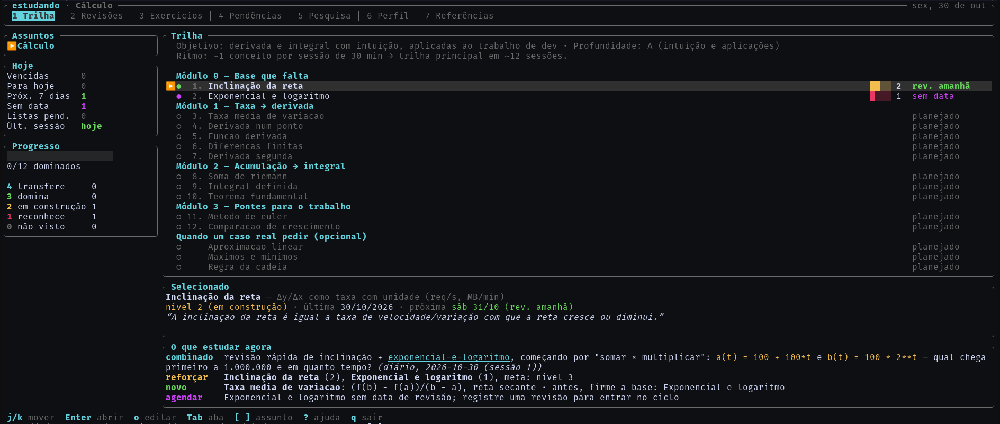

# estudando

Duas peças que trabalham juntas:

- **`skill/professor/`**: skill do Claude Code que faz papel de professor particular. Ela
  diagnostica o que você sabe, monta uma trilha, escreve notas em Markdown (compatíveis com
  o Obsidian), passa exercícios com repetição espaçada e dispara pesquisas.
- **`estudando`**: painel no terminal (Rust + ratatui) que lê essas notas e mostra progresso,
  revisões, exercícios, pendências e o que estudar a seguir. Ele só lê; quem escreve é a
  skill (ou você, pelo editor).



## Instalar

Requer Rust (cargo) e, para a skill, Python 3 e o Claude Code.

```sh
./instalar.sh              # TUI + skill + pergunta onde guardar os estudos
./instalar.sh --sem-skill  # só a TUI
```

O script:

1. roda `cargo install --path . --locked` (binário em `~/.cargo/bin/estudando`);
2. cria o link `~/.claude/skills/professor -> <repo>/skill/professor`, para que editar a
   skill no repositório já valha no Claude Code;
3. pergunta onde guardar os estudos, se isso ainda não estiver configurado.

Depois de mudar o código, rode `./instalar.sh` de novo.

## Onde ficam os estudos

A skill e a TUI usam a mesma pasta base, resolvida nesta ordem:

1. `$ESTUDANDO_DIR`, se estiver definida;
2. `pasta = "..."` em `~/.config/estudando/config.toml` (respeita `$XDG_CONFIG_HOME`).

Se nenhuma das duas existir, nada é criado às cegas. A skill pergunta onde guardar na
primeira sessão e grava a resposta. A TUI mostra como configurar. A sugestão é
`<pasta de documentos do sistema>/Aprendizado`, que vira `~/Documentos/Aprendizado` ou
`~/Documents/Aprendizado` conforme o idioma.

```sh
estudando --pasta                         # qual pasta está em uso e de onde veio
estudando --definir-pasta ~/Estudos       # grava (e cria) a pasta
python3 skill/professor/scripts/arvore.py base [--definir CAMINHO]   # o mesmo, pelo lado da skill
```

Dentro da pasta base fica uma pasta por assunto (`calculo/`, com `_mapa.md`, `_perfil.md`,
`conceitos/`, `exercicios/`, `pesquisa/`). Ela pode ser aberta como vault do Obsidian.

## Usar

```sh
estudando            # abre o primeiro assunto
estudando calculo    # abre direto num assunto (nome da pasta ou prefixo)
estudando --dir ~/outra/pasta   # outra pasta só nesta execução
```

Para começar um assunto, peça ao Claude Code: "quero aprender cálculo". A skill professor
assume a partir daí.

| Aba | O que mostra |
|---|---|
| 1 Trilha | o `_mapa.md` na ordem, com nível e situação da revisão de cada conceito; detalhes do selecionado; "O que estudar agora" |
| 2 Revisões | todos os conceitos ordenados por urgência (vencidas, hoje, futuras, sem data) e o histórico de revisões |
| 3 Exercícios | as listas de `exercicios/`, com status, questões respondidas no arquivo e conceitos cobertos |
| 4 Pendências | revisões vencidas, listas pendentes, equívocos do diagnóstico, perguntas do professor, dúvidas abertas, base frágil, seções suas em branco |
| 5 Pesquisa | os relatórios de `pesquisa/` (pesquisador e atualizações), com as seções de cada um |
| 6 Perfil | o `_perfil.md` (objetivo, diagnóstico, diário) |
| 7 Referências | o `_referencias.md` |

Atalhos: `j/k` mover, `Enter` abrir conceito, lista ou relatório, `o` abrir o arquivo no
`$VISUAL`/`$EDITOR`, `Tab`/`1-7` abas, `[`/`]` assunto, `r` recarregar, `?` ajuda, `q` sair.
As notas são recarregadas sozinhas quando mudam no disco.

Numa lista de exercícios aberta, dicas e gabarito (callouts recolhidos `> [!tip]-` e
`> [!check]-`) ficam **ocultos**: `d` mostra as dicas e `g` mostra o gabarito. Uma questão
conta como respondida quando há texto depois de `**Sua resposta:**`. Responda pelo `o`, no
editor, ou no chat com o professor.

## "O que estudar agora"

Em ordem de prioridade:

1. **revisar**: conceitos com `proxima_revisao` vencida ou para hoje;
2. **exercícios**: listas sem `status: corrigido`, da mais antiga para a mais nova;
3. **combinado**: o "Próximo:" da entrada mais recente do diário no `_perfil.md`;
4. **reforçar**: conceitos da trilha com nota e nível abaixo de 3;
5. **novo**: o primeiro conceito da trilha principal (módulos não opcionais) que ainda não
   tem nota, avisando se algum anterior está abaixo do nível 2;
6. **agendar**: conceitos sem `proxima_revisao`, fora do ciclo de revisão.

## Formato esperado

O formato é o descrito em `~/.claude/skills/professor/references/arvore-conhecimento.md`.
As regras de leitura (frontmatter, pastas ignoradas, "base frágil") são as mesmas do
`arvore.py` da skill.
